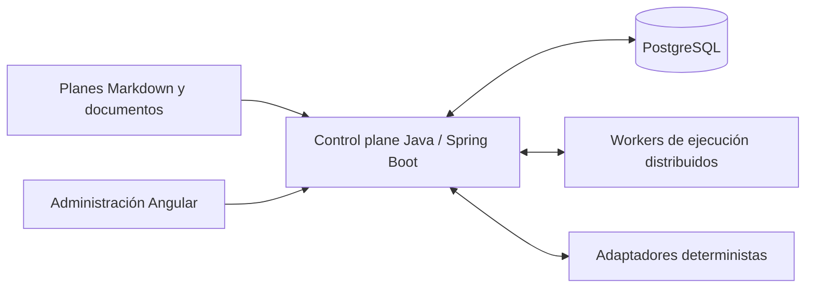

# Weekly AI Work Planner

**Orquestación de ingeniería asistida por IA, consciente de la capacidad y las dependencias entre proyectos.**

[English](README.md) · Español

Weekly AI Work Planner explora cómo convertir planes de ingeniería en sesiones breves y trazables de trabajo con IA, respetando límites de recursos, dependencias, incidentes y aprobaciones humanas.

**Estado actual: diseño técnico y prototipo ejecutable de validación PostgreSQL.** La arquitectura funcional (D1) está aprobada. El diseño de dominio consolidado (D2) está pendiente de revisión. Todavía no hay una aplicación de planificación, una flota de workers ni una interfaz web ejecutables.

## Qué problema aborda

Coordinar varias herramientas de IA y varios proyectos exige decidir qué ejecutar, con qué recurso, qué dependencias bloquean el trabajo y cómo recuperar una operación interrumpida después de cambiar un sistema externo.

El diseño propone:

- **Capacidad por recurso:** ventanas de cuota, reservas, consumo, confianza y reparto inicial 70% planificación / 20% incidentes / 10% incertidumbre.
- **Trabajo consciente de dependencias:** tareas y capabilities entre proyectos, compatibilidad verificada de versión/entorno y prioridad heredada solo por los caminos bloqueantes.
- **Sesiones breves:** context packs versionados, espacios de trabajo aislados, intentos acotados, evidencia y checkpoints.
- **Ejecución recuperable:** leases, fencing, comandos idempotentes, eventos transaccionales y reconciliación antes de repetir un efecto externo incierto.
- **Gobierno humano:** aprobación de acciones sensibles, historia inmutable y ningún cambio automático a APIs comerciales de pago.

Las entradas previstas son planes Markdown de Gentle-AI y documentos de negocio/técnicos sincronizados con herramientas como Google Drive y Plane. Los parsers y adaptadores reales son trabajo futuro.

## Qué se puede ejecutar hoy

El repositorio incluye migraciones PostgreSQL, propuestas de contratos de persistencia y una batería Java/JUnit. Comprueba contabilidad de capacidad, relaciones, concurrencia, estados, recuperación y procedencia con **datos sintéticos y adaptadores simulados**.

La ejecución registrada del **17 de octubre de 2026** completó **147 comprobaciones sin fallos, errores ni omisiones**, con PostgreSQL 16.15 y Java 21. Algunas pruebas históricas reproducen deliberadamente huecos de versiones anteriores. Consulta el [resumen de validación](docs/validation/README.md) para conocer el alcance y los límites.

### Ejecutar la auditoría

Requisitos: Bash, daemon Docker operativo y acceso a los registros de imágenes y Maven Central. Docker debe poder acceder al repositorio mediante bind mount. Java y Maven se ejecutan dentro del contenedor de pruebas.

```bash
git clone https://github.com/isidorotrevino/weekly-ai-work-planner.git
cd weekly-ai-work-planner
bash testing/D2/run-docker-audit.sh
```

El ejecutor crea cinco bases desechables en un contenedor PostgreSQL temporal, ejecuta Flyway/JUnit y elimina sus contenedores y red al terminar. No publica puertos del host. Guarda logs, metadatos y reportes en `work/docker-audit/`, excluido de Git. Utiliza la batería únicamente con datos de prueba desechables.

La [guía de auditoría](testing/D2/README.md) explica la alternativa con PostgreSQL local y cómo seleccionar otras imágenes.

## Arquitectura propuesta



El diagrama representa el sistema previsto. El prototipo actual valida contratos de persistencia PostgreSQL; no inicia esos servicios.

| Componente | Tecnología prevista |
|---|---|
| Control plane | Java 21+ / Spring Boot, monolito modular |
| Estado y cola transaccional | PostgreSQL, Flyway, leases y polling HTTPS |
| Recursos de ejecución | Workers CLI/modelo con presupuestos independientes |
| Administración | Angular, en una fase posterior |
| Integración | Adaptadores deterministas y versionados, con detección de conflictos |

El MVP propuesto no requiere Kafka, Temporal ni Kubernetes. Los worktrees aíslan cambios; no son sandboxes de seguridad.

## Organización del repositorio

```text
.
├── README.md / README.es.md    Presentación en inglés y español
├── docs/
│   ├── design/                D1 aprobado y borrador D2 consolidado
│   │   └── history/           Iteraciones anteriores
│   ├── validation/            Cobertura, límites y resultados portables
│   └── archive/sql-markdown/  Mirrors históricos de V1–V4
├── migrations/                SQL V1–V4 preservado
├── migrations-proposed/       Correcciones y contratos V5–V10 en borrador
├── testing/D2/                Batería Java/JUnit y ejecutores
├── scripts/                   Comprobaciones previas a publicación
└── .github/                   Plantillas de issues y pull requests
```

Los adjuntos originales, notas de continuidad, evidencia bruta, credenciales, cachés y archivos de bases de datos se conservan localmente, excluidos de Git.

### Por dónde empezar

1. [Índice de documentación](docs/README.md).
2. [Arquitectura aprobada — D1](docs/design/D1-architecture-baseline.md).
3. [Borrador consolidado de D2](docs/design/D2.8-consolidated-review.md).
4. [Matriz de validación](docs/validation/D2-VALIDATION-MATRIX.md) y [resultados portables](docs/validation/latest-results.json).

Las migraciones originales V1–V4 y las propuestas V5–V10 se mantienen separadas. Superar las pruebas no aprueba una propuesta ni la convierte en migración de producción.

## Hoja de ruta

| Etapa | Alcance | Estado |
|---|---|---|
| D1 | Arquitectura funcional | Aprobada |
| D2 | Dominio y contratos PostgreSQL | Borrador consolidado; revisión pendiente |
| D3 | Planificación consciente de capacidad | Prevista |
| D4 | Protocolo de workers y recuperación real | Prevista |
| D5 | Ingestión e integraciones | Prevista |
| D6 | Gobierno y operación | Prevista |

## Contribuciones y seguridad

Consulta [CONTRIBUTING.md](CONTRIBUTING.md) antes de proponer cambios y [SECURITY.md](SECURITY.md) antes de compartir información de diagnóstico.

Antes de preparar un commit, ejecuta:

```bash
python3 scripts/check-publication.py
```

La comprobación revisa archivos versionados y no ignorados para detectar patrones habituales de credenciales, rutas privadas y artefactos generados. Es una protección ligera, no un escáner exhaustivo de secretos. Revisa también el diff preparado: `.gitignore` no protege archivos que Git ya versiona.

## Licencia

Este proyecto utiliza la **GNU General Public License, versión 3 exclusivamente** (`GPL-3.0-only`). Consulta [LICENSE](LICENSE), [NOTICE](NOTICE) y la [guía bilingüe de licencia](LICENSING.md).

Puedes usarlo, modificarlo y redistribuirlo, también comercialmente. Al distribuir una versión modificada cubierta por la GPL, debe conservarse esa licencia y proporcionarse el código fuente correspondiente según sus condiciones. Se permiten modificaciones privadas que no se distribuyan; GPLv3 no incorpora la obligación de ofrecer fuentes por uso en red propia de AGPL.
