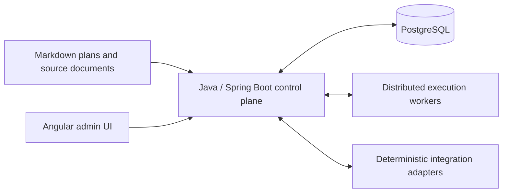

# Weekly AI Work Planner

**Capacity-aware orchestration for AI-assisted engineering across multiple projects.**

English · [Español](README.es.md)

Weekly AI Work Planner explores how to turn engineering plans into short, traceable AI work sessions while respecting resource limits, project dependencies, incidents, and human approval boundaries.

**Current stage: technical design and an executable PostgreSQL validation prototype.** The functional architecture (D1) is approved. The consolidated domain design (D2) is awaiting review. There is no runnable planner application, worker fleet, or web interface yet.

## Why this project exists

Running several AI tools across several projects creates a coordination problem: what should run next, which resource can handle it, what is blocked, and what happens when execution stops halfway through an external change?

The proposed planner addresses that problem through:

- **Resource-specific capacity:** separate quota windows, reservations, consumption, confidence, and a default 70% planned / 20% incident / 10% uncertainty allocation.
- **Dependency-aware work:** task and capability dependencies across projects, verified version/environment compatibility, and priority inheritance along blocking paths.
- **Short execution sessions:** versioned context packs, isolated workspaces, bounded attempts, evidence, and checkpoints.
- **Recoverable execution:** leases and fencing, idempotent commands, transactional events, and reconciliation before retrying an uncertain external effect.
- **Human governance:** approval for sensitive actions, immutable history, and no automatic fallback to paid commercial APIs.

The intended inputs are Gentle-AI Markdown plans and business/technical documents synchronized with tools such as Google Drive and Plane. Their real parsers and adapters are future work.

## What you can run today

The repository includes PostgreSQL migrations, proposed persistence contracts, and a Java/JUnit audit harness. It validates capacity accounting, relationships, concurrency, state changes, recovery decisions, and provenance using **synthetic data and simulated adapters**.

The recorded validation run on **October 17, 2026** completed **147 checks with zero failures, errors, or skipped checks** on PostgreSQL 16.15 and Java 21. Some historical checks deliberately reproduce gaps in older schema versions. See the [validation overview](docs/validation/README.md) for the scope and limitations.

### Run the database audit

Requirements: Bash, a working Docker daemon, and access to the image registries and Maven Central. The repository must be available to Docker for the bind mount. Java and Maven run inside the test container.

```bash
git clone https://github.com/isidorotrevino/weekly-ai-work-planner.git
cd weekly-ai-work-planner
bash testing/D2/run-docker-audit.sh
```

The runner creates five disposable databases in a temporary PostgreSQL container, runs Flyway and JUnit, and removes its own containers and network afterward. It publishes no host ports. Logs, image metadata, and reports are written to the ignored `work/docker-audit/` directory. Use this harness only with disposable test data.

For local PostgreSQL execution and image overrides, see the [audit guide](testing/D2/README.md).

## Proposed architecture



This diagram describes the planned system. The current prototype covers PostgreSQL persistence contracts; it does not start these services.

| Component | Intended technology |
|---|---|
| Control plane | Java 21+ / Spring Boot modular monolith |
| Transactional state and queue | PostgreSQL, Flyway, leases and HTTPS polling |
| Execution resources | Independently budgeted CLI/model workers |
| Administration | Angular, in a later phase |
| Integration | Deterministic, versioned adapters with conflict detection |

Kafka, Temporal, and Kubernetes are not required for the proposed MVP. Worktrees provide change isolation; they are not security sandboxes.

## Repository map

```text
.
├── README.md / README.es.md    English and Spanish project introductions
├── docs/
│   ├── design/                Approved D1 and consolidated D2 draft
│   │   └── history/           Earlier design iterations
│   ├── validation/            Coverage, limitations, and portable results
│   └── archive/sql-markdown/  Historical readable mirrors of V1–V4
├── migrations/                Preserved V1–V4 SQL
├── migrations-proposed/       Draft V5–V10 corrections and contracts
├── testing/D2/                Java/JUnit audit harness and runners
├── scripts/                   Publication hygiene checks
└── .github/                   Issue and pull request templates
```

Original attachments, local continuity notes, raw audit evidence, credentials, caches, and database files stay local and are excluded from Git.

### Start reading

1. [Documentation index](docs/README.md).
2. [Approved architecture — D1](docs/design/D1-architecture-baseline.md).
3. [Consolidated D2 review draft](docs/design/D2.8-consolidated-review.md) — currently in Spanish.
4. [Validation matrix](docs/validation/D2-VALIDATION-MATRIX.md) and [portable results](docs/validation/latest-results.json).

The original V1–V4 migrations and the V5–V10 proposals are kept separate on purpose. Passing the audit does not approve a proposal or make it a production migration.

## Roadmap

| Stage | Scope | Status |
|---|---|---|
| D1 | Functional architecture | Approved |
| D2 | Domain model and PostgreSQL contracts | Consolidated draft; review pending |
| D3 | Capacity-aware scheduling | Planned |
| D4 | Worker protocol and real recovery | Planned |
| D5 | Source ingestion and integrations | Planned |
| D6 | Governance and operations | Planned |

## Contributing and security

Read [CONTRIBUTING.md](CONTRIBUTING.md) before proposing design or code changes, and [SECURITY.md](SECURITY.md) before sharing diagnostic information.

Before staging files, run the local publication check:

```bash
python3 scripts/check-publication.py
```

It inspects tracked and unignored files for common credential patterns, private paths, and generated artifacts. It is a lightweight safeguard, not a comprehensive secret scanner. Review the staged diff as well; `.gitignore` does not protect files already tracked by Git.

## License

This project is licensed under the **GNU General Public License v3.0 only** (`GPL-3.0-only`). See [LICENSE](LICENSE), [NOTICE](NOTICE), and the [bilingual licensing guide](LICENSING.md).

You may use, modify, and redistribute it, including commercially. When conveying a covered modified version, the GPL requires that it remain under the GPL and that the corresponding source be provided as required by the license. Private modifications that are not conveyed are allowed; ordinary GPLv3 does not impose AGPL-style source-offer obligations merely for network use.
