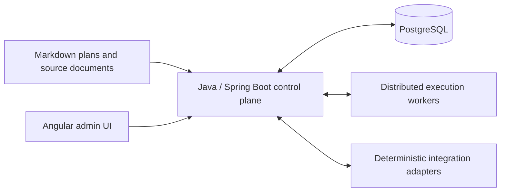

# Weekly AI Work Planner

**Capacity-aware orchestration for AI-assisted engineering across multiple projects.**

English · [Español](README.es.md)

Weekly AI Work Planner explores how to turn engineering plans into short, traceable AI work sessions while respecting resource limits, project dependencies, incidents, and human approval boundaries.

**Current stage: Java 21 planning core, PostgreSQL contracts and a runnable synthetic Docker laboratory.** D1, D2 and D3 are approved and closed. D4 includes fixture workers, HTTPS transport, independent verification, checkpoints and recovery; its bounded synthetic scope is approved and closed. See the [approved D4 scope](docs/design/D4-approved.md) and [closure manifest](docs/validation/D4-CLOSURE.json). Real providers, physical deployment and a production web application remain future work.

Next session: [Docker Compose development environment and README simplification](HANDOFF-DEV-ENV.md). This is a handoff; the development environment is pending implementation.

## Why this project exists

Running several AI tools across several projects creates a coordination problem: what should run next, which resource can handle it, what is blocked, and what happens when execution stops halfway through an external change?

The proposed planner addresses that problem through:

- **Resource-specific capacity:** separate quota windows, reservations, consumption, confidence, and a default 70% planned / 20% incident / 10% uncertainty allocation.
- **Dependency-aware work:** task and capability dependencies across projects, verified version/environment compatibility, and priority inheritance along blocking paths.
- **Short execution sessions:** versioned context packs, isolated workspaces, bounded attempts, evidence, and checkpoints.
- **Recoverable execution:** leases and fencing, idempotent commands, transactional events, and reconciliation before retrying an uncertain external effect.
- **Human governance:** approval for sensitive actions, immutable history, and no automatic fallback to paid commercial APIs.

The intended inputs are Gentle-AI Markdown plans and business/technical documents synchronized with tools such as Google Drive and Plane. Their real parsers and adapters are future work.

## What you can run today

The repository includes PostgreSQL migrations, proposed persistence contracts, and a Java/JUnit audit harness. It validates capacity accounting, relationships, concurrency, state changes, recovery decisions, and provenance using **synthetic data and simulated adapters**.

The recorded validation run on **October 17, 2026** completed **157 checks with zero failures, errors, or skipped checks** on PostgreSQL 16.15 and Java 21. The suite includes 29,829 SemVer/npm conformance vectors within one JUnit check. Some historical checks deliberately reproduce gaps in older schema versions. See the [validation overview](docs/validation/README.md) for the scope and limitations.

### Test the planning core

The [scheduler-core](scheduler-core/README.md) module computes deterministic proposals over synthetic snapshots, without executing operations or publishing plans. Run `bash testing/D3/run-core-tests.sh` with Java 21/Maven, or `bash testing/D3/run-core-docker-tests.sh`. See [D3 implementation status](docs/design/D3-IMPLEMENTATION.md) and [JUnit evidence](docs/validation/D3-I1-results.json). The [PostgreSQL adapter](scheduler-postgres/README.md) now adds immutable snapshots and transactional publication and [guarded dispatch](docs/design/D3-I3-DISPATCH.md). Run its isolated suite with `bash testing/D3/run-postgres-tests.sh`.

The [callable durable coordinator](docs/design/D3-COORDINATOR.md) batches events, persists sweeps and fences publication with bounded recalculation. No worker, daemon or service is deployed.

The [integrated D3 review](docs/design/D3-REVIEW.md) fixes critical incident reopening in V15 and records bounded scale measurements. The conservative scope was accepted as 1A; [optimization 2A](docs/design/D3-OPTIMIZATION.md) now completes the 1,000-operation fixture with its 30 s budget. D3 is [approved and closed as the conservative MVP](docs/design/D3-approved.md), without deployment approval.

### Run the database audit

Requirements: Bash, a working Docker daemon, and access to the image registries and Maven Central. The repository must be available to Docker for the bind mount. Java and Maven run inside the test container.

```bash
git clone https://github.com/isidorotrevino/weekly-ai-work-planner.git
cd weekly-ai-work-planner
bash testing/D2/run-docker-audit.sh
```

The runner creates six disposable databases in a temporary PostgreSQL container, runs Flyway and JUnit, and removes its own containers and network afterward. It publishes no host ports. Logs, image metadata, and reports are written to the ignored `work/docker-audit/` directory. Use this harness only with disposable test data.

For local PostgreSQL execution and image overrides, see the [audit guide](testing/D2/README.md).

## Proposed architecture



This diagram describes the planned system. The current prototype covers PostgreSQL persistence contracts; it does not start these services.

| Component | Intended technology |
|---|---|
| Control plane | Java 21+ / Spring Boot modular monolith |
| Transactional state and queue | PostgreSQL, Flyway, leases and HTTPS polling |
| Execution resources | Independently budgeted CLI/model workers |
| Administration | Angular, in a later phase |
| Integration | Deterministic, versioned adapters with conflict detection |

Kafka, Temporal, and Kubernetes are not required for the proposed MVP. Worktrees provide change isolation; they are not security sandboxes.

## Repository map

```text
.
├── README.md / README.es.md    English and Spanish project introductions
├── docs/
│   ├── design/                Approved D1 and D2 design
│   │   └── history/           Earlier design iterations
│   ├── validation/            Coverage, limitations, and portable results
│   └── archive/sql-markdown/  Historical readable mirrors of V1–V4
├── migrations/                Preserved V1–V4 SQL
├── migrations-proposed/       Draft V5–V11 corrections and contracts
├── scheduler-core/            Java 21 planning core / Núcleo Java 21
├── scheduler-postgres/        JDBC snapshot and publication adapter / Adaptador JDBC
├── migrations-d3-proposed/    I2 V12 isolated proposal / Propuesta I2 aislada
├── migrations-d3-dispatch-proposed/  I3 V13 dispatch / Despacho
├── migrations-d3-coordinator-proposed/  V14 callable coordination / Coordinación
├── testing/D2/                Java/JUnit audit harness and runners
├── scripts/                   Publication hygiene checks
└── .github/                   Issue and pull request templates
```

Original attachments, local continuity notes, raw audit evidence, credentials, caches, and database files stay local and are excluded from Git.

### Start reading

1. [Documentation index](docs/README.md).
2. [Approved architecture — D1](docs/design/D1-architecture-baseline.md).
3. [Approved D2 domain design](docs/design/D2.9-approved.md) — currently in Spanish.
4. [Validation matrix](docs/validation/D2-VALIDATION-MATRIX.md) and [portable results](docs/validation/latest-results.json).

The original V1–V4 migrations and the V5–V11 proposals are kept separate on purpose. Design approval does not promote these proposals to production migrations; deployment preflight remains required.

## Roadmap

| Stage | Scope | Status |
|---|---|---|
| D1 | Functional architecture | Approved |
| D2 | Domain model and PostgreSQL contracts | Approved and closed; validation prototype |
| D3 | Capacity-aware scheduling | Approved and closed; conservative MVP 1.0, validated libraries/SQL |
| D4 | Worker protocol and synthetic recovery lab | Approved and closed; synthetic scope |
| D5 | Source ingestion and integrations | Planned |
| D6 | Governance and operations | Planned |

## Contributing and security

Read [CONTRIBUTING.md](CONTRIBUTING.md) before proposing design or code changes, and [SECURITY.md](SECURITY.md) before sharing diagnostic information.

Before staging files, run the local publication check:

```bash
python3 scripts/check-publication.py
```

It inspects tracked and unignored files for common credential patterns, private paths, and generated artifacts. It is a lightweight safeguard, not a comprehensive secret scanner. Review the staged diff as well; `.gitignore` does not protect files already tracked by Git.

## License

This project is licensed under the **GNU General Public License v3.0 only** (`GPL-3.0-only`). See [LICENSE](LICENSE), [NOTICE](NOTICE), and the [bilingual licensing guide](LICENSING.md).

You may use, modify, and redistribute it, including commercially. When conveying a covered modified version, the GPL requires that it remain under the GPL and that the corresponding source be provided as required by the license. Private modifications that are not conveyed are allowed; ordinary GPLv3 does not impose AGPL-style source-offer obligations merely for network use.

Third-party attribution is maintained in [THIRD-PARTY-NOTICES.md](THIRD-PARTY-NOTICES.md).

[D4 I4 integrated Compose laboratory](docs/design/D4-I4-LAB.md) and [separate evidence](docs/validation/D4-I4-results.json). At I4 issuance D4 remained open; see the current closure above. No deployment or migration promotion.

[D4 I6 renewal and cooperative checkpoint](docs/design/D4-I6-LONG-RUNNING-LAB.md):
nine synthetic scenarios and [separate results](docs/validation/D4-I6-results.json).
At I6 issuance D4 remained open; bounded scope, no real providers.

[D4 I7 normal polling and verified retirement](docs/design/D4-I7-POLLING-LAB.md),
with [twelve recorded scenarios](docs/validation/D4-I7-results.json).

[D4 I11: A21 verified revisions and A22 physical quarantine](docs/design/D4-I11-REVIEW-QUARANTINE-LAB.md),
with [bounded synthetic campaigns and regressions](docs/validation/D4-I11-REVIEW-QUARANTINE-results.json).
At I11 issuance D4 remained open; the later explicit closure is recorded above.

[D4 I12: Java verifiers and durable worker presence](docs/design/D4-I12-INTEGRATED-VERIFIERS-PRESENCE.md),
with the integrated V30 matrix. Final D4 review and explicit user approval are recorded in the closure manifest.
